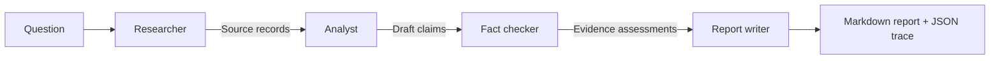

# Multi-Agent Research System

A runnable, inspectable Python research pipeline with four specialized agents: **Researcher → Analyst → Fact Checker → Report Writer**. Uses the Wikipedia MediaWiki API for source discovery and an OpenAI-compatible chat-completions endpoint for synthesis. Every source is tracked by an ID, URL, and excerpt.

> **Important:** This is a portfolio/reference implementation, not a guarantee of factual correctness. The fact checker flags unsupported claims using an LLM; it does not independently establish truth. Always review citations and primary sources before publishing.

## Architecture



## Quick start

Requires **Python 3.10+**; no third-party dependencies for the core application.

```bash
python -m venv .venv
source .venv/bin/activate
cp .env.example .env
# Edit .env and supply OPENAI_API_KEY; or export it in your shell
set -a; source .env; set +a
python main.py "What are the main technical challenges of retrieval-augmented generation?" --output examples/report.md
```

Run without API credentials using a deterministic **demo** (does not perform live research):

```bash
python main.py --demo --output examples/demo-report.md
```

Run tests:

```bash
python -m unittest discover -s tests -v
```

## Configuration

| Variable | Purpose | Default |
|---|---|---|
| `OPENAI_API_KEY` | API key for OpenAI-compatible chat completions | Required for live run |
| `OPENAI_MODEL` | Model ID supported by your endpoint | `gpt-4.1-mini` |
| `OPENAI_BASE_URL` | Base URL ending in `/v1` | `https://api.openai.com/v1` |
| `RESEARCH_MAX_SOURCES` | Max Wikipedia pages to retrieve | `5` |

No browser scraping or paid search service is needed. Wikipedia is a convenient demonstration source, but it is **not** sufficient for all research tasks. A future iteration should add domain-specific retrieval, scholarly sources, source-date checks, and stronger verification.

## Outputs

- Markdown report with inline source identifiers such as `[S1]` and a linked references section.
- JSON trace (`<output>.json`) containing query, sources, claims, fact-check assessments, and report.
- A `--demo` mode for reviewers without credentials.

## Evaluation

`python -m evaluation.benchmarks` runs a small deterministic evidence-reference metric. For rigorous benchmarking, add a labeled dataset and measure citation precision, factuality, retrieval recall, cost, and latency.

## Security and limitations

- Treat retrieved text as untrusted data, not instructions. The prompts explicitly separate source content from instructions, but prompt injection is still possible.
- No code execution or filesystem access is delegated to the model.
- Avoid sending sensitive data to external APIs. Source snippets and your question are sent to the configured model provider.
- Fact-checking is **evidence consistency assessment**, not independent external verification.
- Wikipedia search may return irrelevant pages. Reports may contain errors; verify consequential claims manually.
- API calls may incur usage charges. This example uses timeouts and modest response limits, but has no comprehensive cost cap.

## Roadmap

- [ ] Add Crossref/OpenAlex academic retrieval and source freshness scoring
- [ ] Implement source diversity and relevance reranking
- [ ] Introduce independent evidence retrieval per claim
- [ ] Build a labeled evaluation set with citation-level precision/recall
- [ ] Add human-in-the-loop approval and observability dashboard

## License

MIT. See [LICENSE](LICENSE).
